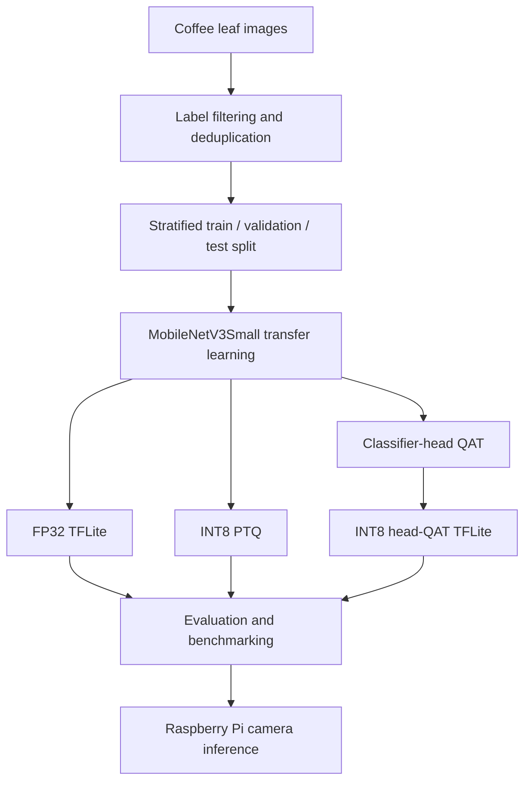

# CaféGuard PR

**Hardware-aware coffee leaf disease classification for resource-constrained edge devices.**

CaféGuard PR explores how lightweight computer vision and model compression can support agricultural disease screening on Raspberry Pi hardware. The system classifies coffee leaf images as healthy or affected by coffee leaf rust, with a long-term goal of supporting growers in Puerto Rico.

## Architecture



## Features

- MobileNetV3Small with ImageNet transfer learning and selective fine-tuning.
- Binary classification: healthy vs. coffee leaf rust.
- Exact-image deduplication, stratified data splitting and training augmentation.
- FP32 and full-integer INT8 TensorFlow Lite model export.
- Comparison of accuracy, macro precision, recall, F1, model size and inference latency.
- Raspberry Pi deployment script with USB and CSI camera support, quantized inference and benchmarking.

## Model compression

| Variant | Approach |
| --- | --- |
| FP32 | Floating-point baseline |
| INT8 PTQ | Post-training integer quantization using representative training images |
| INT8 head-QAT | Quantization-aware fine-tuning of the classifier head; frozen backbone quantized during conversion |

Both INT8 exports require integer inputs and outputs. Head-QAT is selective, not whole-network quantization-aware training.

## Getting started

Open [the training and quantization notebook](CafeGuard_PR_Training_Quantization.ipynb) in Google Colab, preferably with a GPU runtime.

1. Install the dependencies using the notebook's setup cells (TensorFlow 2.20.0, legacy Keras and TensorFlow Model Optimization).
2. Configure the dataset source. The default Hugging Face quickstart downloads approximately 1.84 GB; alternatively, select `upload_zip` for labeled images.
3. Run dataset ingestion, splitting, training, quantization and export sections. Skip the optional existing-deployment ZIP upload and reevaluation cells if training from scratch.
4. Evaluate the exported models and generate the deployment bundle.

The input format is 224 × 224 RGB pixels in the range 0–255. MobileNetV3Small includes its own preprocessing; the inference script handles integer quantization and output dequantization.

## Dataset sources

- [Arabica Coffee Leaf Disease Classification](https://huggingface.co/datasets/Project-AgML/arabica_coffee_leaf_disease_classification) — default demonstration dataset.
- [RoCoLe](https://data.mendeley.com/datasets/c5yvn32dzg/2) — intended research dataset from Ecuador. Mite-only examples are excluded from the binary task.

The quickstart removes exact duplicates before splitting, but near-duplicates and repeated views of the same plant may remain. Plant-grouped evaluation is recommended before drawing research-level conclusions. Puerto Rican field performance has not been established.

## Raspberry Pi deployment

After generating and extracting the deployment ZIP, transfer the models, `labels.json` and `cafeguard_pi_camera.py` to the Pi. Install a compatible LiteRT/TFLite runtime, NumPy, Pillow, and OpenCV (USB camera) or Picamera2 (CSI camera).

Example commands:

```bash
python3 cafeguard_pi_camera.py --model cafeguard_int8_ptq.tflite --benchmark 100 --frames 200
python3 cafeguard_pi_camera.py --model cafeguard_fp32.tflite --camera usb --show
```

## Evaluation and project status

The intended performance targets are at least 85% held-out accuracy and less than 500 ms per image. These are design targets, not measured results.

- [x] Training and quantization notebook implemented
- [x] FP32, INT8 PTQ and INT8 head-QAT export workflow implemented
- [x] Raspberry Pi camera inference script included in notebook
- [ ] Publish trained model artifacts and deployment bundle
- [ ] Verify sustained live camera inference on physical hardware
- [ ] Publish reproducible Raspberry Pi benchmarks and final evaluation results
- [ ] Evaluate generalization to Puerto Rican farm conditions

Colab CPU timings must not be interpreted as Raspberry Pi timings. This repository currently contains the notebook source, rather than the generated model weights or dataset.

## Technologies

Python · TensorFlow · Keras · TensorFlow Model Optimization · TensorFlow Lite · MobileNetV3 · OpenCV · Raspberry Pi · NumPy · scikit-learn

## Author

Samantha Kaufman — Computer Engineering, University of Massachusetts Amherst.

*Research and engineering prototype; not a validated agricultural diagnostic system.*
